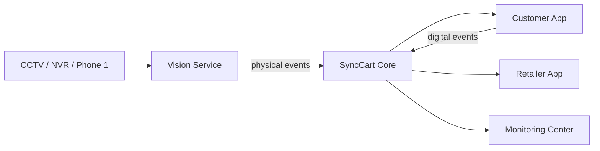

# SyncCart AI Architecture

SyncCart AI is an event-driven retail reconciliation platform with four major boundaries:

1. **Retail Edge Vision** — CCTV/NVR/Phone camera ingestion and physical shelf evidence.
2. **SyncCart Core** — session, cart, event, reconciliation, discrepancy, review, and checkout state.
3. **Customer Experience** — Scan-and-Go cart and private nudges.
4. **Operations** — retailer exception management and AI/system observability.

## Design rules

- Cameras produce evidence, not business truth.
- Domain writes are idempotent where duplicates are possible.
- Physical and digital cart projections remain independent.
- Reconciliation is deterministic and explainable.
- Customer, retailer, monitoring, simulator, and Vision access boundaries are separate.
- No face-recognition dependency exists in the transaction path.

## Camera contract

The same `OpenCVCameraSource` accepts RTSP, HTTP/MJPEG, webcam indexes, and recorded files. Camera credentials are redacted from logs. `DETECTOR_MODE=AUTO` chooses YOLO when optional weights are available and otherwise runs the fixed-zone reference detector.

## Event contract

Physical events are normalized to `VISION_PICKUP` / `VISION_RETURN`; digital actions produce `PRODUCT_SCANNED` / `DIGITAL_ITEM_REMOVED`. The Core API reconciles both through temporal matching and discrepancy state.

For detailed diagrams, see `docs/architecture/` and `docs/vision/`.
