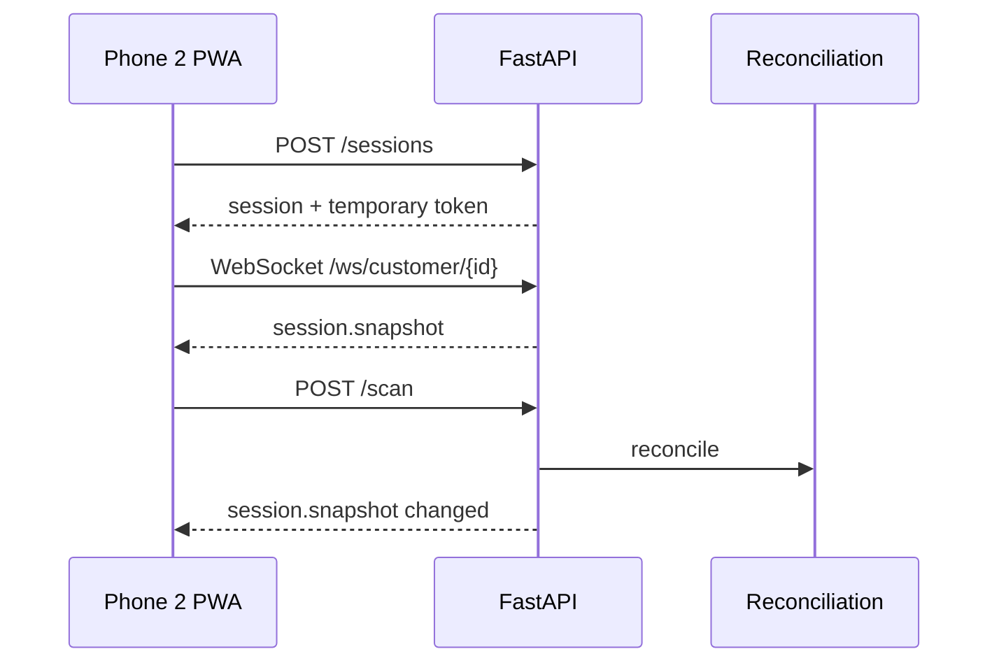

# Customer PWA architecture

## Responsibilities

- create an anonymous shopping session;
- hold the temporary session token in `sessionStorage` only;
- scan or manually enter a barcode;
- show the digital cart and cart total;
- receive realtime reconciliation snapshots;
- present neutral soft nudges;
- capture customer nudge intent without faking physical evidence;
- run simulated checkout and display exit clearance.

## Realtime flow

## Camera constraints

Live browser camera access requires a secure context on most mobile browsers. On a local `http://192.168.x.x` development URL, camera APIs may be unavailable. The Phase 4 app therefore includes manual barcode entry as a deterministic demo fallback. HTTPS/tunnel/local certificate deployment is addressed during demo hardening.

## Product specification

For the complete shopper journey, features, trust rules, and hackathon/retail deployment notes, see [`docs/product/customer-app.md`](../product/customer-app.md).
