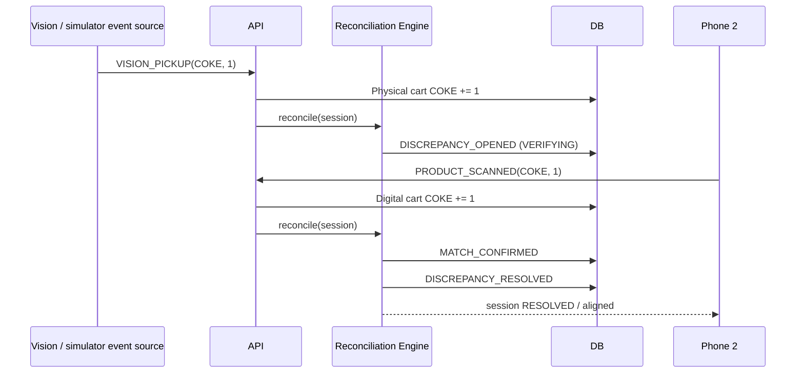
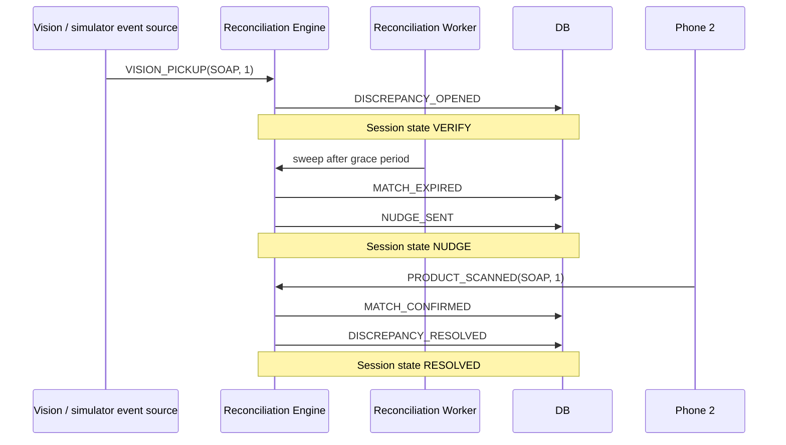

# Event Flow

All domain events are immutable, use UUID identifiers, and are timestamped in UTC.

## Normal matched purchase



## Missed scan



## State progression

```text
Aligned cart
    |
    v
  CLEAR

Mismatch appears
    |
    v
  VERIFY
    |
    | grace expires
    v
  NUDGE       (physical quantity ahead of digital)
    |
    | remains unresolved
    v
  REVIEW

Any point where cart becomes aligned
    |
    v
  RESOLVED
```

A digital-ahead mismatch is treated conservatively. It enters `VERIFY`, but after the grace period it escalates to `REVIEW` rather than accusing the shopper or sending an inappropriate missed-scan nudge.
