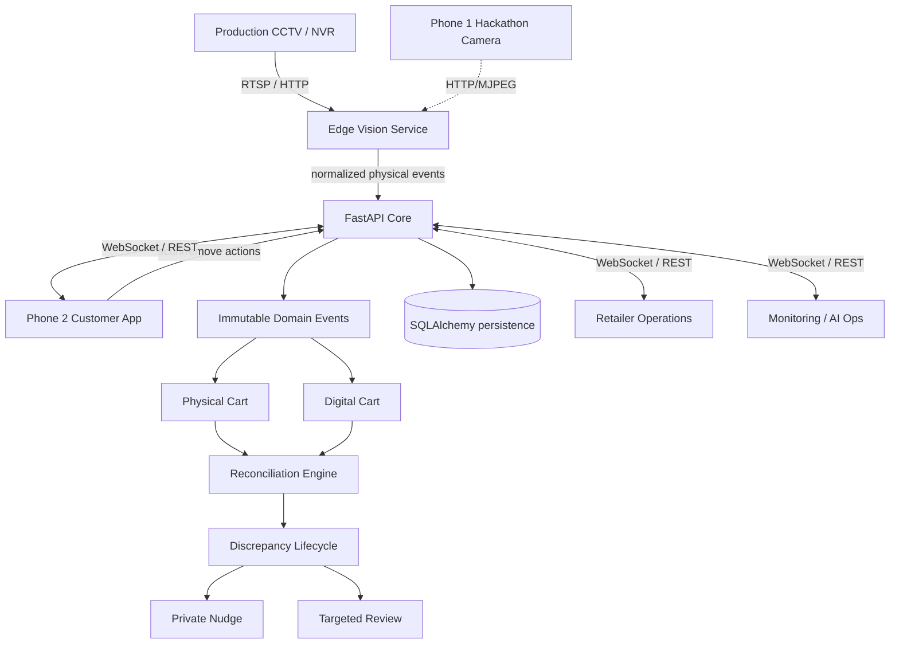

# System Overview — Production-Oriented Architecture

SyncCart AI is an event-driven retail reconciliation platform composed of a transactional core, an edge Vision service, and three role-specific applications.

## Camera model

Production uses **fixed retail CCTV/IP cameras or NVR/VMS channels**. The hackathon uses **Phone 1** as a portable IP-camera emulator. Both feed the same OpenCV camera boundary.

## Service responsibilities

### Core API

Owns durable business state and transaction evidence:

- anonymous shopping sessions;
- product catalog lookup;
- digital cart mutations;
- normalized physical cart events;
- idempotency;
- immutable domain events;
- physical/digital projections;
- temporal event matching;
- discrepancy state transitions;
- private nudges;
- checkout reconciliation;
- retailer review workflow;
- monitoring snapshots.

### Vision service

Owns camera/inference runtime, not transaction truth:

- CCTV/NVR/Phone/webcam/video source lifecycle;
- credential-redacted diagnostics;
- model loading;
- planogram mapping;
- per-zone SKU counts;
- count stabilization;
- frozen-frame detection and reconnect;
- preview / snapshot endpoints;
- camera/model telemetry;
- safe arm/disarm controls;
- physical-event publication.

### Customer app

Owns the shopper's temporary Scan-and-Go interaction and session token.

### Retailer app

Owns colleague exception handling and intentionally hides low-level engineering controls.

### Monitoring app

Owns engineering/AI observability and reconciliation inspection.

## Key design decision

The camera never becomes the cart database. It is a sensor. The Vision service proposes normalized physical events; the Core decides how they affect cart projections and reconciliation. This keeps Vision uncertainty at the edge while preserving deterministic transaction logic centrally.

## Persistence

- SQLite is the local development/demo default.
- SQLAlchemy models and Alembic migrations provide a PostgreSQL-ready path.
- raw video is not required as transactional persistence.

## Realtime

WebSockets provide low-latency snapshots while REST remains the recovery/fallback path.

## Watched-zone attribution boundary

The controlled live Vision flow uses one eligible active shopper in the watched zone. If attribution is ambiguous, publication is blocked rather than guessed. The normalized event boundary allows a separate attribution service to be added in larger deployments.
