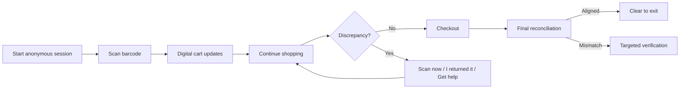

# Customer App — Product and Technical Specification

## Purpose

The Customer App is the shopper-facing Scan-and-Go experience. It owns the digital cart and the private interaction loop when physical shelf evidence and the scanned cart temporarily disagree.

## Primary journey



## Main features

- anonymous temporary shopping session;
- barcode scanner with manual-entry fallback;
- live digital cart and quantities;
- duplicate-scan suppression;
- product removal;
- private product-specific nudges;
- `SCAN NOW`, `I RETURNED IT`, `GET HELP` actions;
- realtime WebSocket snapshots;
- REST recovery path;
- checkout reconciliation;
- clear-to-exit state.

## Trust rule

`I RETURNED IT` records the shopper's statement. It does not manufacture a physical return. The physical cart changes only through Vision evidence or an explicit retailer resolution.

## Authentication boundary

The customer receives a temporary session token that is separate from retailer, monitoring, simulator, and Vision credentials. Browser state is session-scoped rather than stored as a permanent shopper identity.

## Privacy behavior

The customer flow does not require facial recognition, demographic inference, emotion recognition, or persistent biometric identity. Nudges refer to the product discrepancy, not to intent.

## Hackathon profile

Phone 2 runs the PWA over the laptop's local network address. The same API contract can be hosted behind HTTPS in a retailer deployment without changing customer-domain behavior.

## API integration

```text
POST /api/v1/sessions
GET  /api/v1/sessions/{session_id}/cart
POST /api/v1/sessions/{session_id}/scan
POST /api/v1/sessions/{session_id}/cart/items/{sku}/remove
POST /api/v1/sessions/{session_id}/nudges/{nudge_id}/action
POST /api/v1/sessions/{session_id}/checkout
GET  /api/v1/products/barcode/{barcode}
WS   /ws/customer/{session_id}
```

Scan/remove mutations use idempotency keys so retries do not duplicate cart events.

## Source map

```text
apps/customer-web/src/App.tsx
apps/customer-web/src/components/CartList.tsx
apps/customer-web/src/features/scanner/BarcodeScanner.tsx
packages/api-client/
packages/realtime-client/
packages/shared-types/
packages/design-system/
services/api/app/api/v1/sessions.py
services/api/app/api/v1/customer_actions.py
services/api/app/api/ws/customer.py
```
