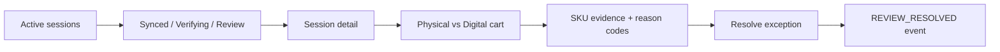

# Retailer Operations App — Product and Technical Specification

## Purpose

The Retailer Operations App is the store colleague's exception-management surface. It converts reconciliation evidence into a small, explainable review queue instead of asking staff to inspect every shopper.

## Operational journey



## Main features

- store overview;
- active-session list;
- synchronized / verifying / review-required states;
- physical-vs-digital cart comparison;
- SKU quantity deltas;
- Vision confidence and reason codes;
- immutable event timeline;
- exception-only review queue;
- targeted correction workflow;
- WebSocket live updates with REST fallback;
- operational metrics without exposing engineering controls.

## Resolution integrity

The retailer app never fabricates a customer scan. If physical evidence was incorrect, the resolution remains on the physical/review side. If the shopper needs to scan an item, the scan must originate from the customer transaction API.

## Access boundary

The local release uses a store-operations key that is separate from customer, monitoring, simulator, and Vision credentials. Enterprise identity systems can bind to the same authorization boundary without changing the store workflow or API surface.

## API integration

```text
GET  /api/v1/store/overview
GET  /api/v1/store/sessions
GET  /api/v1/store/sessions/{session_id}
GET  /api/v1/store/reviews
POST /api/v1/store/reviews/{discrepancy_id}/resolve
WS   /ws/store?key=<STORE_KEY>
```

## Source map

```text
apps/retailer-web/src/App.tsx
packages/api-client/
packages/realtime-client/
packages/shared-types/
services/api/app/api/v1/store_ops.py
services/api/app/services/store_operations.py
services/api/app/api/ws/store.py
```
