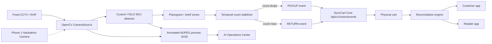

# Vision Runtime Architecture

## Production path

The camera adapter accepts RTSP CCTV/NVR, HTTP/MJPEG, webcam indexes and recorded video. Phone 1 uses HTTP/MJPEG during the hackathon but is not the intended store hardware.

## Camera security

RTSP URLs may contain credentials at runtime. SyncCart's camera adapter exposes a credential-redacted representation for diagnostics. Real credentials remain in `.env` or a deployment secret store and should never be committed.

## Controlled shelf boundary

The edge worker performs SKU detection and stable shelf-count changes. It does **not** infer criminal intent and does **not** use face recognition. Camera-to-session attribution is safe only when exactly one eligible shopping session is active in the watched zone. Ambiguous attribution suppresses publication rather than guessing.

## Detector contract

`YoloDetector` requires custom weights at `models/weights/synccart-sku-v001.pt` by default. Missing weights put Vision into `DEGRADED`; they do not trigger synthetic detections.

## Count stabilization

Per-frame detections become counts inside calibrated zones. A new count must persist for `STABLE_FRAME_COUNT` observations before becoming stable. Only stable differences create physical events.

This avoids hand-action recognition in the release shelf profile and reduces noisy pickup events caused by brief occlusions.

## Operational controls

- event emission is disarmed by default;
- arming resets the stabilizer and requires a fresh baseline;
- frozen-frame detection triggers degraded state / reconnect;
- cooldown suppresses duplicate transitions;
- monitoring reports camera/model state explicitly.
